**English** | [简体中文](README.md)

<picture>
  <source media="(max-width: 640px) and (prefers-color-scheme: dark)" srcset="assets/presentation/hero-mobile-dark.svg">
  <source media="(max-width: 640px)" srcset="assets/presentation/hero-mobile-light.svg">
  <source media="(prefers-color-scheme: dark)" srcset="assets/presentation/hero-dark.svg">
  
</picture>

**Explicitly label untrusted inputs, propagate provenance through instrumented tool calls, and report affected side-effecting actions.**

`v0.9.0` · `Python 3.12+` · [Apache-2.0](LICENSE)

[Website](https://tainttrace.lei6393.com) · [Demo record](docs/demo-results.json)

## Why use it

An action log alone does not identify which outputs used untrusted content. TaintTrace relies on boundary labels and tracked tools to preserve propagation. It reports a review list from recorded dependencies and side-effect flags; it neither decides whether content is malicious nor automatically isolates running actions.

## Architecture

<picture>
  <source media="(max-width: 640px) and (prefers-color-scheme: dark)" srcset="assets/presentation/architecture-mobile-dark.svg">
  <source media="(max-width: 640px)" srcset="assets/presentation/architecture-mobile-light.svg">
  <source media="(prefers-color-scheme: dark)" srcset="assets/presentation/architecture-dark.svg">
  
</picture>

label.py defines label sets; wrap.py propagates them through synchronous or asynchronous tool inputs and outputs, with optional JSONL recording by Tracker. graph.py rebuilds dependencies, and quarantine.py computes reachable actions and filters side effects. The CLI supplies tables, graphs and JSON.

The demo functions named web_fetch, write_file, git_commit and send_message return strings and do not perform those external operations. See [wrap.py](src/tainttrace/wrap.py) and [tracker.py](src/tainttrace/tracker.py) for core interfaces.

## Install

Requires Python 3.12+. All demo tool functions are local fixtures, with no network, real file writes or messages.

```bash
git clone https://github.com/SuperMarioYL/tainttrace.git
cd tainttrace
python3 -m venv .venv
source .venv/bin/activate
python -m pip install -e .
```

## Quickstart

The real built-in eleven-action scenario and a three-action script exercise propagation and reporting. Network, commit and send names are simulated; clean only means no label was reached in the recorded graph.

```bash
python -m tainttrace.cli demo
python examples/presentation_demo.py
```

The built-in demo needs no file; the complete minimal script is [examples/presentation_demo.py](examples/presentation_demo.py).

## Usage

Use a Tracker context or activate/deactivate, decorate tools with tracked, and call taint_source at untrusted boundaries. report --trace FILE reconstructs a report; --graph shows the graph and --source ID filters a source. Preserve actual data dependencies and labels; action names cannot recover complete influence.

## Recorded demo

<picture>
  <source media="(max-width: 640px) and (prefers-color-scheme: dark)" srcset="assets/presentation/process-mobile-dark.svg">
  <source media="(max-width: 640px)" srcset="assets/presentation/process-mobile-light.svg">
  <source media="(prefers-color-scheme: dark)" srcset="assets/presentation/process-dark.svg">
  
</picture>

### Built-in propagation scenario

Run the eleven-action label flow through simulated functions.

```text
$ python -m tainttrace.cli demo
╭─ tainttrace demo ────────────────────────────────────────────────────────────────────────────────╮
│ Poisoned-web demo: a fetched page carried a prompt injection. Tracing how its taint propagated   │
│ through the agent's tool graph…                                                                  │
╰──────────────────────────────────────────────────────────────────────────────────────────────────╯
                                          Tool-call graph
┏━━━━━━━━━━━━━━━━━━━━━━━━┳━━━━━━━━━━━━━━━━━━━┳━━━━━━━━━━━━━━━━━━┳━━━━━━━━━━━━━━━━━━━┳━━━━━━━━━━━━━━┓
┃ call id                ┃ tool              ┃   side-effect    ┃ depends on        ┃    taint     ┃
┡━━━━━━━━━━━━━━━━━━━━━━━━╇━━━━━━━━━━━━━━━━━━━╇━━━━━━━━━━━━━━━━━━╇━━━━━━━━━━━━━━━━━━━╇━━━━━━━━━━━━━━┩
│ web_fetch-1            │ web_fetch         │        —         │ —                 │    clean     │
│ web_fetch-2            │ web_fetch         │        —         │ —                 │    clean     │
│ web_fetch-3            │ web_fetch         │        —         │ —                 │    clean     │
│ summarize-4            │ summarize         │        —         │ web_fetch-2       │  ● tainted   │
│ summarize-5            │ summarize         │        —         │ web_fetch-1       │    clean     │
│ plan-6                 │ plan              │        —         │ summarize-4       │  ● tainted   │
│ write_file-7           │ write_file        │        ✓         │ plan-6            │  ● tainted   │
│ write_file-8           │ write_file        │        ✓         │ summarize-5       │    clean     │
│ git_commit-9           │ git_commit        │        ✓         │ write_file-7      │  ● tainted   │
│ read_file-10           │ read_file         │        —         │ web_fetch-3       │    clean     │
│ send_message-11        │ send_message      │        ✓         │ read_file-10      │    clean     │
└────────────────────────┴───────────────────┴──────────────────┴───────────────────┴──────────────┘

╭────────────────────────────────────────────────────────────────╮
│ 4 of 11 actions tainted  ·  2 to quarantine  ·  7 proven clean │
╰────────────────────────────────────────────────────────────────╯
Untrusted sources: web:cve-blog

                       Quarantine list — side-effecting actions to roll back
┏━━━━━━┳━━━━━━━━━━━━━━━┳━━━━━━━━━━━━━┳━━━━━━━┳━━━━━━━━━━━━━━┳━━━━━━━━━━━━━━━━━━━━━━━━━━━━━━━━━━━━━━┓
┃    # ┃ call id       ┃ tool        ┃  hops ┃ tainted by   ┃ why                                  ┃
┡━━━━━━╇━━━━━━━━━━━━━━━╇━━━━━━━━━━━━━╇━━━━━━━╇━━━━━━━━━━━━━━╇━━━━━━━━━━━━━━━━━━━━━━━━━━━━━━━━━━━━━━┩
│    1 │ write_file-7  │ write_file  │     2 │ web:cve-blog │ poisoned web page (prompt injection) │
│    2 │ git_commit-9  │ git_commit  │     3 │ web:cve-blog │ poisoned web page (prompt injection) │
└──────┴───────────────┴─────────────┴───────┴──────────────┴──────────────────────────────────────┘

                    Influenced (tainted, no side effect) — review, not roll back
┏━━━━━━━━━━━━━━━━━━━━━━━━━━━━━┳━━━━━━━━━━━━━━━━━━━━━━━━┳━━━━━━━━━━━━━┳━━━━━━━━━━━━━━━━━━━━━━━━━━━━━┓
┃ call id                     ┃ tool                   ┃        hops ┃ tainted by                  ┃
┡━━━━━━━━━━━━━━━━━━━━━━━━━━━━━╇━━━━━━━━━━━━━━━━━━━━━━━━╇━━━━━━━━━━━━━╇━━━━━━━━━━━━━━━━━━━━━━━━━━━━━┩
│ summarize-4                 │ summarize              │           0 │ web:cve-blog                │
│ plan-6                      │ plan                   │           1 │ web:cve-blog                │
└─────────────────────────────┴────────────────────────┴─────────────┴─────────────────────────────┘

Proven clean (7): web_fetch-1, web_fetch-2, web_fetch-3, summarize-5, write_file-8, read_file-10,
send_message-11
```

### Minimal complete script

Two of three actions carry the label; one has a side-effect flag.

```text
$ python examples/presentation_demo.py
{
  "total_actions": 3,
  "tainted_count": 2,
  "quarantine_count": 1,
  "clean_count": 1,
  "sources": [
    "fixture:input"
  ],
  "headline": "2 of 3 actions tainted, 1 proven clean",
  "quarantine": [
    {
      "id": "simulated_write-2",
      "name": "simulated_write",
      "side_effect": true,
      "reached_by": [
        "fixture:input"
      ],
      "reasons": [
        "explicitly labeled example"
      ],
      "hops": 1
    }
  ],
  "tainted": [
    {
      "id": "transform-1",
      "name": "transform",
      "side_effect": false,
      "reached_by": [
        "fixture:input"
      ],
      "reasons": [
        "explicitly labeled example"
      ],
      "hops": 0
    },
    {
      "id": "simulated_write-2",
      "name": "simulated_write",
      "side_effect": true,
      "reached_by": [
        "fixture:input"
      ],
      "reasons": [
        "explicitly labeled example"
      ],
      "hops": 1
    }
  ],
  "clean_ids": [
    "transform-3"
  ]
}
```

## Capabilities and integration

<picture>
  <source media="(max-width: 640px) and (prefers-color-scheme: dark)" srcset="assets/presentation/integrations-mobile-dark.svg">
  <source media="(max-width: 640px)" srcset="assets/presentation/integrations-mobile-light.svg">
  <source media="(prefers-color-scheme: dark)" srcset="assets/presentation/integrations-dark.svg">
  
</picture>

Propagation depends on wrapped data and call relationships. Uninstrumented paths, unlabeled inputs or label-losing conversions can leave the graph incomplete. The report’s proven clean wording is not a security proof for the whole system.


## Configuration

side_effect=True explicitly marks effects for review. In v0.9.0, successful report --json exits 0; text mode exits 1 for a nonempty quarantine list, and file/format errors exit 2. --strict includes malformed raw lines in errors, so account for sensitive log content when choosing output destinations.

## Roadmap and scope

Explicit instrumentation, synchronous/asynchronous wrapping, JSONL and source-scoped reports are implemented. Automatic framework instrumentation, cross-session analysis and dashboards remain future work. There is no automatic rollback engine.

- Explicit labels and instrumentation are required; arbitrary agent tokens are not automatically tracked.
- Clean is relative to the recorded graph and does not rule out unobserved influence.
- The tool does not roll back, block tools or prove successful exploitation.

[Terminal recording](assets/demo.gif) · [Recording script](docs/demo.tape)

## License

[Apache-2.0](LICENSE)
